<!-- ═══════════════════════════════ 0 · ENCABEZADO ═══════════════════════════════ -->

<picture>
  <source media="(prefers-color-scheme: dark)" srcset="docs/assets/readme/portada-oscuro.webp">
  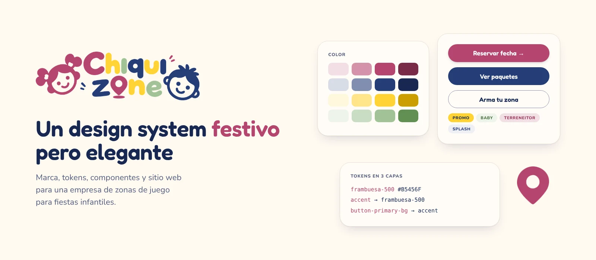
</picture>

<h1 align="center">Chiquizone · Design System y sitio web</h1>

<p align="center">
  La marca, el design system y el sitio de una empresa que renta zonas de juego para fiestas infantiles<br>
  en San Juan del Río y Tequisquiapan, Querétaro. Diseñado con decisiones trazables, de los tokens al código.
</p>

<p align="center">
  
  
  
  
  
  
</p>

<p align="center">
  <a href="#recorrido"><strong>Ver el recorrido</strong></a> ·
  <a href="#el-design-system"><strong>Design system</strong></a> ·
  <a href="#decisiones-que-tomamos"><strong>Decisiones</strong></a> ·
  <a href="#pruébalo"><strong>Instalar</strong></a> ·
  <a href="#cómo-trabajamos"><strong>Flujo de trabajo</strong></a>
</p>

<p align="center">
  <sub>Caso de estudio de <strong>Santiago Hernández</strong> · Product Design, design systems y automatización con IA</sub>
</p>

---

<!-- ═══════════════════════════════ 1 · EL PROBLEMA ═══════════════════════════════ -->

## El problema

Quien organiza una fiesta infantil en casa tiene tres miedos: no tener tiempo para coordinar a varios proveedores, que la fiesta no se vea bien en las fotos y que algo falle el día del evento.

Chiquizone resuelve la parte de la diversión: lleva la zona de juego, la monta, la supervisa y la recoge. Su sitio tenía que transmitir eso en segundos a un papá o una mamá que llega desde WhatsApp o Instagram en el celular, y verse como una marca de alto valor sin perder lo festivo.

> **Esencia de la marca:** festiva pero elegante, con un sentido de alto valor casi de lujo. Divertida, fresca y alegre, con un alto sentido estético y minimalista.

---

<!-- ═══════════════════════════════ 2 · BENCHMARK ═══════════════════════════════ -->

## Lo que dijo el benchmark

Antes de diseñar pantallas analizamos [15 referentes internacionales](docs/benchmark.md) de kits y servicios para fiestas infantiles (Meri Meri, Momo Party, Packed Party, The Party Darling, entre otros). Tres hallazgos guiaron el proyecto:

| Hallazgo | Cómo se tradujo en Chiquizone |
|---|---|
| Las marcas premium usan lienzos crema o marfil y dejan que el color venga de la fotografía | Fondo crema `#FFF9F1`, superficies en blanco hueso `#FFFCF7` y nunca blanco puro |
| Los sitios que convierten eliminan las "matemáticas" del papá | **Arma tu zona**: tres preguntas (edad, agua, cuidadoras) recomiendan el paquete y su precio |
| El miedo logístico es el principal motivo de abandono | **¿Tu fecha está libre?** junto a la acción principal, con fecha y municipio, directo a WhatsApp |

La diferencia clave: los referentes venden cajas por envío; Chiquizone es un **servicio local**. Por eso "llega a tiempo" se volvió "tu fecha está libre" y el SEO apunta a búsqueda local, no a Google Shopping.

---

<!-- ═══════════════════════════════ 3 · DESIGN SYSTEM ═══════════════════════════════ -->

## El design system

### Tokens en tres capas

Una sola fuente de verdad en `tokens/*.json` alimenta el CSS del sitio, el design system documentado y las variables de Figma.

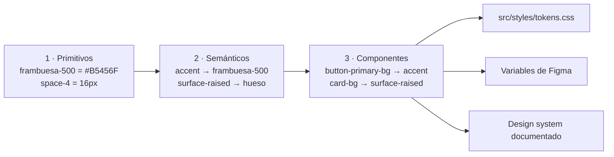

Cada capa solo puede apuntar a la anterior. `scripts/build-tokens.mjs` lo valida, revisa el contraste de cada par fondo/texto (mínimo AA, 4.5:1) y genera el CSS. Hoy son **261 tokens** en dos temas: claro y marino.

### Color

Cuatro escalas de 50 a 900 tomadas del logo: **frambuesa** (acción), **marino** (texto y confianza), **sol** (promociones) y **salvia** (familia Baby). Cada familia de paquete tiene su par tinte/tinta: Baby en salvia, Terreneitor en frambuesa y Splash en marino.

### Tipografía

**Fredoka** para títulos, botones y precios; **Nunito** para texto. La tipografía de títulos está en revisión: el benchmark sugiere una serif editorial para reforzar el lado premium ([decisión abierta](docs/decisiones/0006-tipografia-titulos.md)).

### Componentes

| Componente | Variantes y estados |
|---|---|
| Botón | Primario, Secundario, Contorno, Texto · 40/48/56 px · default, hover, pressed, focus, disabled, loading |
| Etiqueta | Sol, Marca, Baby, Terreneitor, Splash · con o sin ícono |
| Tarjeta de paquete | Por familia, con lista de incluidos y precio |
| Campo | Default, focus, error, disabled · etiqueta siempre visible |
| Pasos | Color rotativo sol → salvia → frambuesa → marino |
| Loader | "El pin que cae": el pin del logo cae y rebota |

Los componentes fueron revisados con las guías de [Impeccable](https://github.com/pbakaus/impeccable): sombras suaves en lugar de sombras duras, estados completos, un solo momento de movimiento por vista y una versión sin movimiento para quien la pide en su dispositivo.

### Movimiento

| Uso | Duración | Curva |
|---|---|---|
| Presionar un botón | 100 ms | `cubic-bezier(.16, 1, .3, 1)` |
| Hover | 160 ms | igual |
| Cambio de estado | 240 ms | igual |
| Entrada de tarjetas | 400 ms | igual |
| Pin que cae (marca) | 700 ms | rebote `cubic-bezier(.34, 1.56, .64, 1)` |

### Íconos

[Phosphor](https://phosphoricons.com) en peso Bold (licencia MIT): su trazo redondeado conversa con Fredoka. Son 37 íconos con nombres en español (`whatsapp`, `bebe`, `agua`, `cuidado`, `fecha-confirmada`…) en `src/icons/`.

---

<!-- ═══════════════════════════════ 4 · RECORRIDO ═══════════════════════════════ -->

## Recorrido

<table>
  <tr>
    <td width="62%">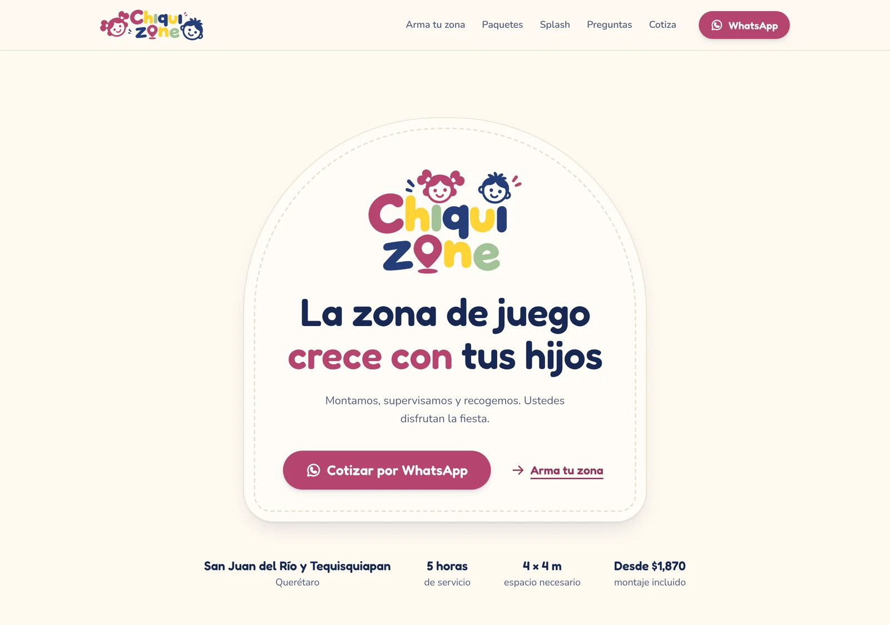</td>
    <td width="38%">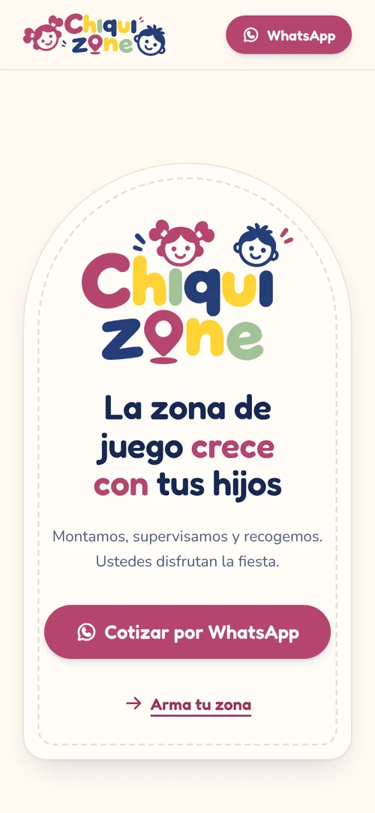</td>
  </tr>
  <tr>
    <td colspan="2"><sub><b>Portada.</b> Un arco con borde punteado enmarca la promesa. Debajo, los cuatro datos que el papá necesita: zona de servicio, horas, espacio y precio desde.</sub></td>
  </tr>
</table>

<p align="center">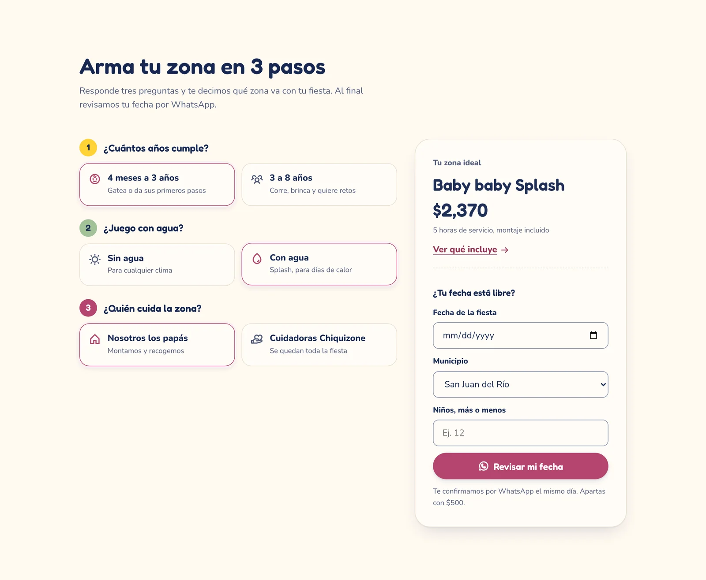</p>
<p align="center"><sub><b>Arma tu zona.</b> Tres preguntas eligen el paquete. A la derecha, el precio y la fecha en el mismo lugar, para que la decisión termine en WhatsApp.</sub></p>

<p align="center">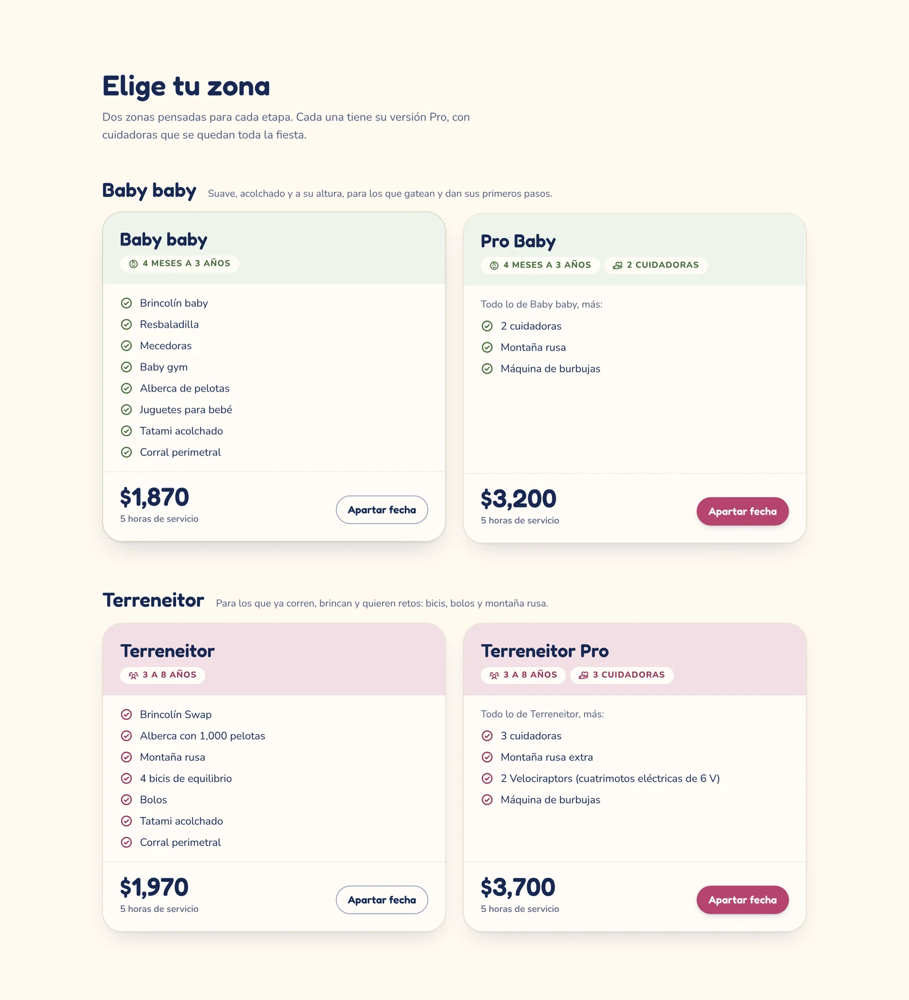</p>
<p align="center"><sub><b>Paquetes.</b> El nombre va primero; la edad y las cuidadoras, como etiquetas con ícono. Cada familia tiene su color.</sub></p>

<p align="center">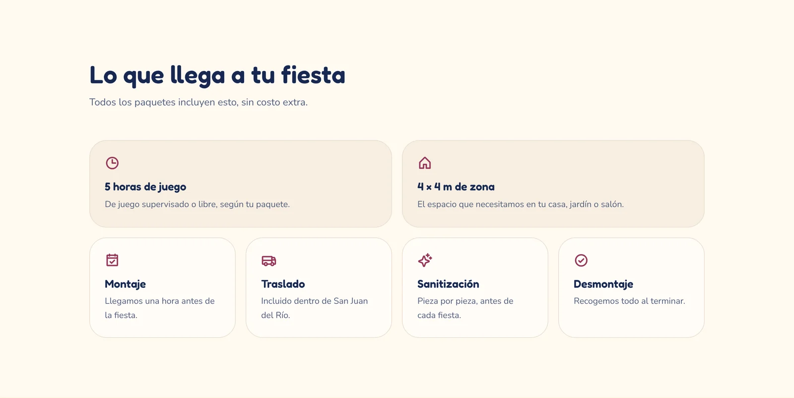</p>
<p align="center"><sub><b>Lo que llega a tu fiesta.</b> Bloques tipo Bento que responden "¿qué me llevo?" antes de que lo pregunten.</sub></p>

<p align="center">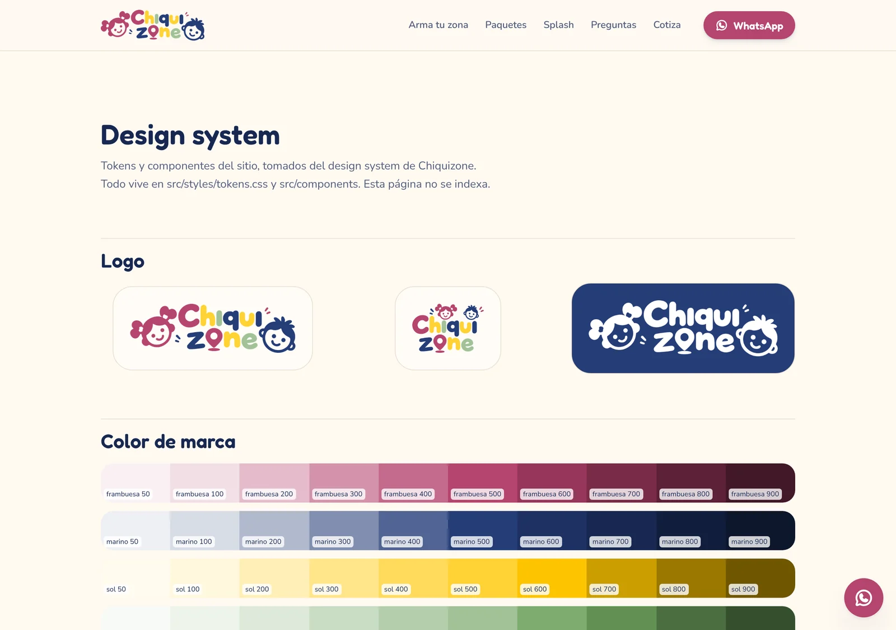</p>
<p align="center"><sub><b>Guía viva.</b> <code>/design-system</code> muestra logos, color, tipografía y cada componente con sus estados, con los mismos tokens que el sitio.</sub></p>

---

<!-- ═══════════════════════════════ 5 · DISEÑO + IA ═══════════════════════════════ -->

## Diseño con IA, decisiones humanas

El sistema se construyó en colaboración con [Claude Code](https://claude.com/claude-code). La regla fue clara desde el inicio: **la IA propone, el diseñador decide.**

- Antes de construir cada componente, Claude consultaba variantes, tamaños y estados. Ningún componente se construyó sin esa aprobación.
- Las decisiones de marca (la esencia, el blanco hueso, la licencia, la tipografía) quedaron en manos del diseñador y están registradas en [`docs/decisiones/`](docs/decisiones/).
- Cada cambio entra por pull request con su origen documentado: benchmark, design system, Figma o una petición del negocio.

---

<!-- ═══════════════════════════════ 6 · ARQUITECTURA ═══════════════════════════════ -->

## Del diseño al código

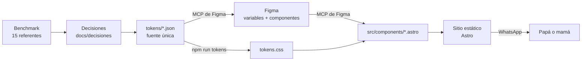

### Stack

| Capa | Tecnología |
|---|---|
| Sitio | Astro 5, HTML estático, JavaScript solo en el configurador y el formulario |
| Estilos | CSS con custom properties generadas desde tokens |
| Tokens | JSON en 3 capas + script de validación y contraste (`scripts/build-tokens.mjs`) |
| Diseño | Figma: variables por capa, estilos de texto y sombra, componentes con variantes |
| Íconos | Phosphor Bold (MIT) |
| SEO | Datos estructurados de negocio local, servicio con precios y preguntas frecuentes; Open Graph |
| Conversión | WhatsApp con mensaje prellenado; sin formularios que guarden datos personales |
| Calidad | GitHub Actions: tokens al día y build en cada pull request |

---

<!-- ═══════════════════════════════ 7 · DECISIONES ═══════════════════════════════ -->

## Decisiones que tomamos

**Blanco hueso, nunca blanco puro.** El blanco crudo se sentía clínico al lado del crema. Las tarjetas y campos usan `#FFFCF7`; el blanco puro solo queda como color de texto sobre frambuesa y marino. [ADR 0002](docs/decisiones/0002-blanco-hueso.md)

**Tres capas de tokens, no una paleta suelta.** Cambiar el color de acción es cambiar una línea en `2-semanticos.json`, y el botón, las etiquetas y los pasos se actualizan solos. [ADR 0001](docs/decisiones/0001-tokens-en-tres-capas.md)

**El contraste se valida al generar, no al revisar.** Si un par fondo/texto baja de 4.5:1, el script falla y el cambio no entra. [ADR 0001](docs/decisiones/0001-tokens-en-tres-capas.md)

**WhatsApp como checkout.** El público ya decide por WhatsApp. El sitio arma el mensaje (paquete, fecha, municipio, niños) y lo entrega listo; no guarda datos personales. [ADR 0004](docs/decisiones/0004-servicio-local-whatsapp.md)

**Una librería de íconos real.** Nada de emojis como íconos: Phosphor Bold, curado y con nombres en español. [ADR 0003](docs/decisiones/0003-iconos-phosphor.md)

**Caras modificadas con IA.** Las fotos de niños se modifican con IA para que ninguna cara mostrada sea real. [ADR 0005](docs/decisiones/0005-imagenes-de-ninos.md)

---

<!-- ═══════════════════════════════ 8 · PRUÉBALO ═══════════════════════════════ -->

## Pruébalo

Necesitas Node 20 o superior.

```bash
git clone https://github.com/SantHdz/Chiquizone-Governance.git
cd Chiquizone-Governance
npm install
npm run dev        # http://localhost:4321
```

| Comando | Qué hace |
|---|---|
| `npm run tokens` | Valida los tokens y genera `src/styles/tokens.css` |
| `npm run dev` | Tokens + servidor de desarrollo |
| `npm run build` | Tokens + sitio estático en `dist/` |
| `npm run seo` | Revisa el SEO del último build (títulos, canonical, datos estructurados, enlaces, mapa del sitio) |
| `npm run check` | Lo mismo que corre CI: tokens al día, build y SEO |

### Dónde se cambia cada cosa

| Qué | Archivo |
|---|---|
| Precios, paquetes, lo que incluyen y cuáles se muestran (`disponible`) | `src/data/paquetes.ts` |
| Complementos, combos, sus precios y en qué paquete se ofrecen | `src/data/complementos.ts` |
| Páginas por tema, sus títulos y descripciones (SEO), mapa del sitio y `llms.txt` | `src/data/seo.ts` |
| Datos estructurados (schema.org) | `src/lib/schema.ts` |
| Teléfono, WhatsApp, zonas, anticipo | `src/data/site.ts` |
| Colores, espacios, componentes | `tokens/*.json` (nunca `tokens.css` a mano) |
| Componentes | `src/components/` |
| Página principal | `src/pages/index.astro` |

---

<!-- ═══════════════════════════════ 9 · FLUJO ═══════════════════════════════ -->

## Cómo trabajamos

Todo cambio entra por pull request, para saber quién cambió qué, cuándo y por qué. El detalle está en [CONTRIBUTING.md](CONTRIBUTING.md).

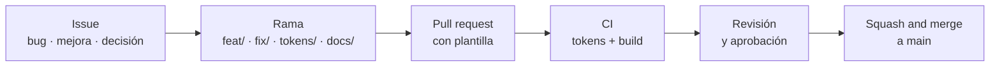

---

<!-- ═══════════════════════════════ 10 · ESTRUCTURA ═══════════════════════════════ -->

## Estructura del repositorio

<details>
<summary><strong>Ver árbol</strong></summary>

```text
.
├── tokens/
│   ├── 1-primitivos.json          # escalas de color, espacio, radios, tipografía, motion
│   ├── 2-semanticos.json          # roles: surface, ink, accent, familias… (temas claro y marino)
│   ├── 3-componentes.json         # button-*, badge-*, card-*, input-*, step-*, loader-*
│   ├── 4-compat-web.json          # alias que usa el sitio
│   └── build/                     # exportación para el design system documentado
├── scripts/build-tokens.mjs       # valida capas y contraste, genera el CSS
├── src/
│   ├── components/                # Button, PackageCard, ArmaTuZona, Faq, Loader, Icon…
│   ├── data/                      # paquetes.ts, complementos.ts y site.ts: la única fuente de precios y datos
│   ├── icons/                     # 37 íconos Phosphor Bold
│   ├── layouts/Base.astro         # SEO, Open Graph y datos estructurados
│   ├── pages/                     # index.astro y design-system.astro (guía viva)
│   └── styles/                    # tokens.css (generado) y base.css
├── public/brand/                  # logos y pin
├── docs/
│   ├── benchmark.md               # resumen del benchmark y cómo se aplicó
│   ├── decisiones/                # registro de decisiones de diseño (ADR)
│   └── assets/readme/             # imágenes de este README
└── .github/                       # CI, plantillas de PR e issues, CODEOWNERS
```

</details>

---

<!-- ═══════════════════════════════ 11 · PRÓXIMOS PASOS ═══════════════════════════════ -->

## Próximos pasos

Se siguen como [issues del milestone Fase 2](https://github.com/SantHdz/Chiquizone-Governance/milestones).

- **Tipografía de títulos.** Probar una serif editorial suave contra Fredoka.
- **Fotografía real.** Una toma cenital numerada por zona para "Qué incluye" y galerías de fiestas reales.
- **Reseñas verificadas** con edad del niño, número de invitados y municipio, conectadas a las estrellas en Google.
- **Activar los demás paquetes.** Al lanzar solo se muestran Baby baby y Pro Baby; Terreneitor y Splash vuelven con `disponible: true` en `src/data/paquetes.ts`.
- **Datos del negocio.** Capacidad por zona y costo de traslado fuera de San Juan del Río. El anticipo (50 %) y la garantía ($500) ya están confirmados.
- **Componentes restantes en Figma**: Etiqueta, Campo, Paso, Tarjeta y Loader.
- **Publicación** en el dominio `chiquizone.com`.

---

<!-- ═══════════════════════════════ 12 · AUTOR ═══════════════════════════════ -->

## Autor

<table>
  <tr>
    <td valign="top">
      <b>Santiago Arturo Hernández Jiménez</b><br>
      <sub>Senior Product Designer · Design Systems · Automation Specialist</sub><br>
      <sub>Dirección de marca, design system, UX y desarrollo del sitio.</sub><br><br>
      <a href="https://www.linkedin.com/in/santhdz-uxui/"></a>
      <a href="https://github.com/SantHdz"></a>
    </td>
  </tr>
</table>

---

## Licencia

**Todos los derechos reservados.** El código es © 2026 Santiago Arturo Hernández Jiménez; la marca Chiquizone, sus logos e imágenes pertenecen a Chiquizone. El repositorio es público para consulta como portafolio, pero nada de su contenido se puede copiar, modificar ni redistribuir sin permiso por escrito. Los íconos de Phosphor conservan su licencia MIT. Ver [LICENSE](LICENSE).

<br>

<picture>
  <source media="(prefers-color-scheme: dark)" srcset="docs/assets/readme/cierre-oscuro.webp">
  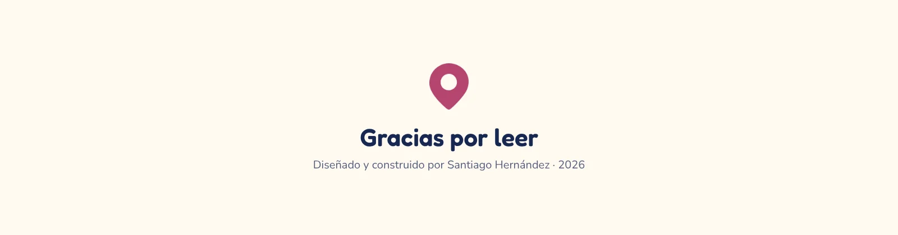
</picture>
