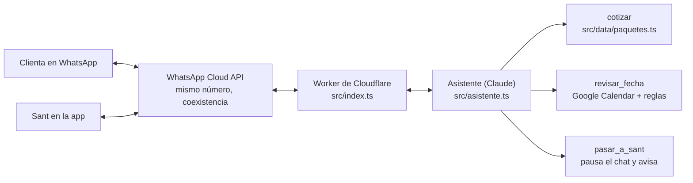

# Asistente de WhatsApp de Chiquizone

Atiende el WhatsApp de Chiquizone: recomienda el paquete, da el precio con el anticipo, revisa si la fecha está libre y, cuando hace falta una persona, le pasa la conversación a Sant. Decisión de origen: [0008](../docs/decisiones/0008-asistente-whatsapp.md).



## Qué hace (fases 1 y 1.5)

| Pieza | Archivo | Qué hace |
|---|---|---|
| Webhook | `src/index.ts` | Verifica la firma de Meta, contesta 200 y procesa en segundo plano |
| Asistente | `src/asistente.ts` | Prompt con la voz de la marca y tres herramientas |
| Precios | `src/cotizar.ts` | Misma lógica que "Arma tu zona", solo con paquetes publicados (`disponible: true`); anticipo y garantía desde `site.ts` |
| Agenda | `src/agenda.ts` | Máximo 2 fiestas por día y 8 horas entre inicios |
| Calendario | `src/calendario.ts` | Lee el día en Google Calendar con una cuenta de servicio |
| Memoria | `src/memoria.ts` | Conversación, pausas y mensajes ya procesados en Cloudflare KV |
| Identidad y registros | `src/db.ts`, `migraciones/` | Clientas por número de WhatsApp; cada respuesta con herramientas, fuentes, latencia y tokens en D1 |
| Conocimiento | `conocimiento/`, `scripts/conocimiento.mjs`, `src/conocimiento.ts` | Archivos curados con metadatos, partidos por sección y citados como fuente |
| Guardia de salida | `src/guardia.ts` | Ningún monto se envía si no salió del servidor |
| Límite de uso | `src/limite.ts` | 30 mensajes por hora por número |

## Seguridad

- Solo se aceptan mensajes firmados por Meta; la identidad es el número del remitente, nunca lo que diga el texto.
- El modelo no ejecuta código ni SQL: elige entre herramientas con esquema estricto y las consultas son fijas.
- El mensaje de la clienta va dentro de `<mensaje_clienta>` como información; se quitan etiquetas que imitan las del sistema.
- Fuera de Chiquizone, respuesta amable y fija; lo que no está en `conocimiento/` no se inventa.
- `npm run eval` corre ataques reales contra el modelo (inyección, precios falsos, suplantar a Sant, temas ajenos). Gasta tokens, por eso no corre en CI.

## Conocimiento (RAG)

Hoy el material completo cabe en el prompt y cada fragmento lleva su id; el modelo marca `[[id]]` y el Worker lo convierte en "_Fuente: …_". La búsqueda vectorial con reranking se enciende cuando el material pase de unas 50 páginas (decisión de Sant, 2026-11-03). Para agregar o cambiar información: edita `conocimiento/`, corre `npm run conocimiento` y abre un PR.

Reglas de convivencia con Sant:

- Si Sant contesta un chat desde la app, el asistente se calla 12 horas en ese chat.
- Fotos, audios y comprobantes se los pasa a Sant.
- El asistente no aparta: junta nombre, fecha, hora, municipio, paquete y niños, y se lo pasa a Sant.

Convención del calendario: cada fiesta es un evento con la hora de la fiesta (no la del montaje). Un evento de día completo bloquea la fecha.

## Probar en local

```bash
npm ci            # en la raíz: el asistente lee los precios del sitio
cd bot && npm ci
npm test          # agenda, precios y webhook
npm run typecheck
```

## Ponerlo en marcha

Lo que necesita Sant, una sola vez:

1. **Google.** Con hola@chiquizone.com (Google Workspace) o un Gmail, crea un calendario "Montajes Chiquizone". En Google Cloud crea un proyecto, activa Google Calendar API, crea una cuenta de servicio y descarga su llave JSON. Comparte el calendario con el correo de la cuenta de servicio con permiso "Hacer cambios en eventos".
2. **Meta.** En developers.facebook.com crea una app de tipo Business con el producto WhatsApp y conecta el número existente con la opción de la app de WhatsApp Business (coexistencia). Anota el Phone number ID, el App secret y un token permanente de usuario del sistema.
3. **Anthropic.** Crea una API key en platform.claude.com.
4. **Cloudflare.** Crea una cuenta gratuita.

Luego, en `bot/`:

```bash
npx wrangler login
npx wrangler kv namespace create CONVERSACIONES   # copia el id a wrangler.toml
npx wrangler d1 create chiquizone                 # copia el id a wrangler.toml
npx wrangler d1 migrations apply chiquizone --remote
# en wrangler.toml, pon el id del calendario en GOOGLE_CALENDAR_ID
for s in ANTHROPIC_API_KEY WA_TOKEN WA_PHONE_NUMBER_ID WA_APP_SECRET WA_VERIFY_TOKEN GOOGLE_SA_EMAIL GOOGLE_SA_KEY; do
  npx wrangler secret put $s
done
npm run deploy
```

Por último, en la app de Meta configura el webhook con la URL `https://chiquizone-asistente.<tu-cuenta>.workers.dev/webhook`, el mismo `WA_VERIFY_TOKEN`, y suscríbelo a los campos `messages` y `smb_message_echoes`.

Avisos opcionales a un número personal: crea una plantilla de utilidad llamada `aviso_conversacion` con un parámetro (por ejemplo, "Chiquizone: un chat necesita tu atención. {{1}}") y guarda el número en el secreto `AVISOS_WA`.

## Pendiente de confirmar

- Horario más temprano y más tarde para una fiesta (hoy: de 9:00 a 23:00, en `src/agenda.ts`).
- Cuándo se paga y se devuelve la garantía de 500 MXN.
- La forma exacta del evento `smb_message_echoes` se valida con el primer mensaje real.
- Modelo: `claude-opus-5-5` con esfuerzo bajo. Si el costo pesa, `claude-haiku-5-5` es mucho más barato; se decide con conversaciones reales.

## Siguientes fases

2. Cierra solo: evento tentativo, cobro del anticipo (pasarela con tarjeta, OXXO y SPEI) y recordatorios.
3. Seguimiento: base de clientes en Google Sheets, seguimiento a cotizaciones y reseñas.
4. Cartera: recontratación por cumpleaños y newsletter.
