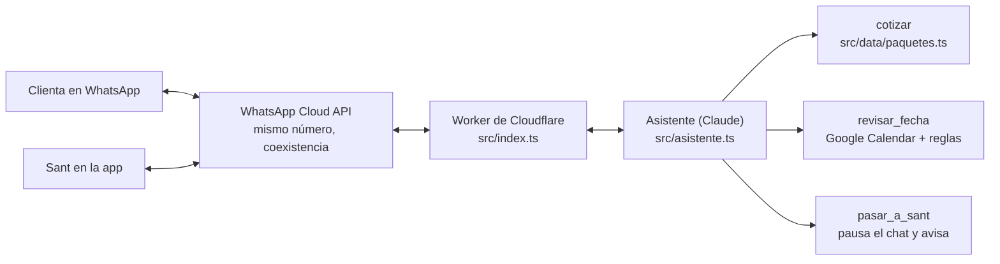

# Asistente de WhatsApp de Chiquizone

Atiende el WhatsApp de Chiquizone: recomienda el paquete, da el precio con el anticipo, revisa si la fecha está libre y, cuando hace falta una persona, le pasa la conversación a Sant. Decisión de origen: [0008](../docs/decisiones/0008-asistente-whatsapp.md).



## Qué hace (fases 1 y 1.5)

| Pieza | Archivo | Qué hace |
|---|---|---|
| Webhook | `src/index.ts` | Verifica la firma de Meta, contesta 200 y procesa en segundo plano |
| Asistente | `src/asistente.ts` | Prompt con la voz de la marca y tres herramientas |
| Precios | `src/cotizar.ts` | Misma lógica que "Arma tu zona", solo con paquetes publicados (`disponible: true`); anticipo y garantía desde `site.ts` |
| Agenda | `src/agenda.ts` | Máximo 2 fiestas por día y 8 horas entre inicios |
| Calendario | `src/calendario.ts` | Lee el día en Google Calendar con una cuenta de servicio |
| Memoria | `src/memoria.ts` | Conversación, pausas y mensajes ya procesados en Cloudflare KV |
| Identidad y registros | `src/db.ts`, `migraciones/` | Clientas por número de WhatsApp; cada respuesta con herramientas, fuentes, latencia y tokens en D1 |
| Conocimiento | `conocimiento/`, `scripts/conocimiento.mjs`, `src/conocimiento.ts` | Archivos curados con metadatos, partidos por sección y citados como fuente |
| Guardia de salida | `src/guardia.ts` | Ningún monto se envía si no salió del servidor |
| Negociación | `src/negociacion.ts` | Descuentos y concesiones con los límites de Sant; el modelo no decide |
| Límite de uso | `src/limite.ts` | 30 mensajes por hora por número |
| Búsqueda (apagada) | `src/busqueda.ts` | Embeddings `bge-m3`, Vectorize y reranker; reindexado incremental |
| Administración | `src/admin.ts`, `src/preguntas.ts` | `/admin/reindexar` y `/admin/comparar`, con `ADMIN_TOKEN` |

## Seguridad

- Solo se aceptan mensajes firmados por Meta; la identidad es el número del remitente, nunca lo que diga el texto.
- El modelo no ejecuta código ni SQL: elige entre herramientas con esquema estricto y las consultas son fijas.
- El mensaje de la clienta va dentro de `<mensaje_clienta>` como información; se quitan etiquetas que imitan las del sistema.
- Fuera de Chiquizone, respuesta amable y fija; lo que no está en `conocimiento/` no se inventa.
- `npm run eval` corre ataques reales contra el modelo (inyección, precios falsos, suplantar a Sant, temas ajenos). Gasta tokens, por eso no corre en CI.

## Conocimiento (RAG)

Cada fragmento lleva su id; el modelo marca `[[id]]` y el Worker lo convierte en "_Fuente: …_". Hay dos modos, con un interruptor en `wrangler.toml` (`MODO_CONOCIMIENTO`):

| Modo | Cómo funciona | Cuándo |
|---|---|---|
| `completo` (hoy) | Todo el material va en el prompt, en caché | Mientras quepa (unas 50 páginas) |
| `busqueda` | La pregunta se convierte en vector (`@cf/baai/bge-m3`), Vectorize trae 20 candidatos, el reranker (`@cf/baai/bge-reranker-base`) deja los 5 mejores y solo esos van con el mensaje | Al crecer el material (decisión de Sant, 2026-11-03) |

En los dos modos el texto sale del repositorio: el índice solo guarda vectores e ids, así que un vector viejo no mete información que ya se quitó. Si la búsqueda falla, el asistente usa todo el material. Cada registro en D1 guarda el modo y los fragmentos que encontró la búsqueda.

Para agregar o cambiar información:

1. Edita `conocimiento/`, corre `npm run conocimiento` y abre un PR. CI revisa que el índice esté al día.
2. Después del deploy, reindexa. Solo se calculan los fragmentos nuevos o cambiados y se borran los que ya no existen:

   ```bash
   curl -X POST -H "authorization: Bearer $ADMIN_TOKEN" https://chiquizone-asistente.<tu-cuenta>.workers.dev/admin/reindexar
   ```

Para decidir cuándo cambiar de modo, `/admin/comparar` corre las preguntas de `src/preguntas.ts` en los dos modos y devuelve, por modo, cuántas citaron la fuente correcta, cuántas encontró el buscador, tokens y latencia. Gasta tokens: se corre a mano.

Reglas de convivencia con Sant:

- Si Sant contesta un chat desde la app, el asistente se calla 12 horas en ese chat.
- Fotos, audios y comprobantes se los pasa a Sant.
- El asistente no aparta: junta nombre, fecha, hora, municipio, paquete y niños, y se lo pasa a Sant.

Convención del calendario: cada fiesta es un evento con la hora de la fiesta (no la del montaje). Un evento de día completo bloquea la fecha.

## Negociación

`src/negociacion.ts` decide los descuentos, no el modelo. El asistente solo puede llamar la herramienta `negociar` (paquetes, fecha de la fiesta y si la clienta pide descuento o algo extra). El servidor responde con el precio final, el anticipo (50 %, igual que `cotizar`) y una guía de qué decir. Los límites son de Sant:

| Regla | Valor |
|---|---|
| Descuento base | 10 % si aplica al menos una: fiesta entre semana, temporada baja, clienta que ya contrató (compras en D1) o 2 servicios o más en el mismo apartado |
| Descuento máximo | 20 % solo en Black Friday, Buen Fin o la 5.ª compra de la clienta |
| Concesiones, en orden | 1) máquina de burbujas, 2) media hora extra, 3) traslado sin costo |
| Ajustes por conversación | Máximo 2. El 10 % se combina con una concesión; el 20 % va solo |
| Piso | Precio del paquete menos 20 %; nunca abajo |
| Arriba del límite | No se baja más: el asistente agradece, ofrece una alternativa (otra fecha entre semana, un paquete más sencillo o guardar el contacto) y deja la puerta abierta |

Si la clienta pide descuento sin motivo, el servidor da la siguiente concesión en vez de bajar el precio. El estado (ajustes ya dados) vive en KV en `neg:<telefono>` por 3 días. Los montos que devuelve la herramienta pasan la guardia de salida, como los de `cotizar`.

Pendiente de confirmar con Sant (constantes al inicio de `src/negociacion.ts`):

- `DIAS_ENTRE_SEMANA`: hoy de lunes a jueves.
- `MESES_TEMPORADA_BAJA`: hoy ninguno.
- `BUEN_FIN` y `BLACK_FRIDAY`: hoy del 13 al 16 y del 27 al 30 de noviembre de 2026. Cuentan por el día en que se aparta, no por la fecha de la fiesta.
- Lecturas de las reglas que conviene confirmar: el 20 % no se suma a ninguna concesión; la 5.ª compra es exactamente la quinta (de la sexta en adelante vuelve al 10 % de clienta frecuente); con una concesión ya dada, una clienta con derecho al 20 % recibe 10 % para no pasar el límite.

## Probar en local

```bash
npm ci            # en la raíz: el asistente lee los precios del sitio
cd bot && npm ci
npm test          # agenda, precios, webhook, seguridad y búsqueda
npm run typecheck
```

## Ponerlo en marcha

Lo que necesita Sant, una sola vez:

1. **Google.** Ya hecho con hola@chiquizone.com (Sant, 2026-11-03): calendario "Chiquizone" (su id está en `wrangler.toml`), proyecto `chiquizone-asistente` con Google Calendar API y cuenta de servicio `asistente@chiquizone-asistente.iam.gserviceaccount.com`. Delegación de todo el dominio autorizada (ID de cliente 111809709629376066934, alcance `calendar.events`): la cuenta actúa en nombre de hola@chiquizone.com (`GOOGLE_SUBJECT` en `wrangler.toml`). Falta la llave JSON: su campo `private_key` se carga como secreto `GOOGLE_SA_KEY`.
   - El calendario se comparte con la cuenta de servicio con "Realizar cambios y ver los detalles de todos los eventos". Para eso, en admin.google.com › Apps › Google Workspace › Calendar › Configuración de uso compartido, el uso compartido externo debe permitir "que los usuarios externos cambien los calendarios".
   - Plan B si Workspace no deja compartirlo: en admin.google.com › Seguridad › Acceso y control de datos › Controles de API › Delegación de todo el dominio, agrega el ID de cliente de la cuenta de servicio con el alcance `https://www.googleapis.com/auth/calendar.events`, y guarda `GOOGLE_SUBJECT=hola@chiquizone.com` como secreto. La cuenta actúa en nombre de hola@ solo para eventos de Calendar.
2. **Meta.** En developers.facebook.com crea una app de tipo Business con el producto WhatsApp y conecta el número existente con la opción de la app de WhatsApp Business (coexistencia). Anota el Phone number ID, el App secret y un token permanente de usuario del sistema.
3. **Anthropic.** Crea una API key en platform.claude.com.
4. **Cloudflare.** Crea una cuenta gratuita.

Luego, en `bot/`:

```bash
npx wrangler login
npx wrangler kv namespace create CONVERSACIONES   # copia el id a wrangler.toml
npx wrangler d1 create chiquizone                 # copia el id a wrangler.toml
npx wrangler d1 migrations apply chiquizone --remote
npx wrangler vectorize create chiquizone-conocimiento --dimensions=1024 --metric=cosine
# en wrangler.toml, pon el id del calendario en GOOGLE_CALENDAR_ID
for s in ANTHROPIC_API_KEY WA_TOKEN WA_PHONE_NUMBER_ID WA_APP_SECRET WA_VERIFY_TOKEN GOOGLE_SA_KEY ADMIN_TOKEN; do
  npx wrangler secret put $s
done
npm run deploy
```

Por último, en la app de Meta configura el webhook con la URL `https://chiquizone-asistente.<tu-cuenta>.workers.dev/webhook`, el mismo `WA_VERIFY_TOKEN`, y suscríbelo a los campos `messages` y `smb_message_echoes`.

Avisos opcionales a un número personal: crea una plantilla de utilidad llamada `aviso_conversacion` con un parámetro (por ejemplo, "Chiquizone: un chat necesita tu atención. {{1}}") y guarda el número en el secreto `AVISOS_WA`.

## Pendiente de confirmar

- Horario más temprano y más tarde para una fiesta (hoy: de 9:00 a 23:00, en `src/agenda.ts`).
- Cuándo se paga y se devuelve la garantía de 500 MXN.
- La forma exacta del evento `smb_message_echoes` se valida con el primer mensaje real.
- Modelo: `claude-opus-5-5` con esfuerzo bajo. Si el costo pesa, `claude-haiku-5-5` es mucho más barato; se decide con conversaciones reales.

## Siguientes fases

2. Cierra solo: evento tentativo, cobro del anticipo (pasarela con tarjeta, OXXO y SPEI) y recordatorios.
3. Seguimiento: base de clientes en Google Sheets, seguimiento a cotizaciones y reseñas.
4. Cartera: recontratación por cumpleaños y newsletter.
